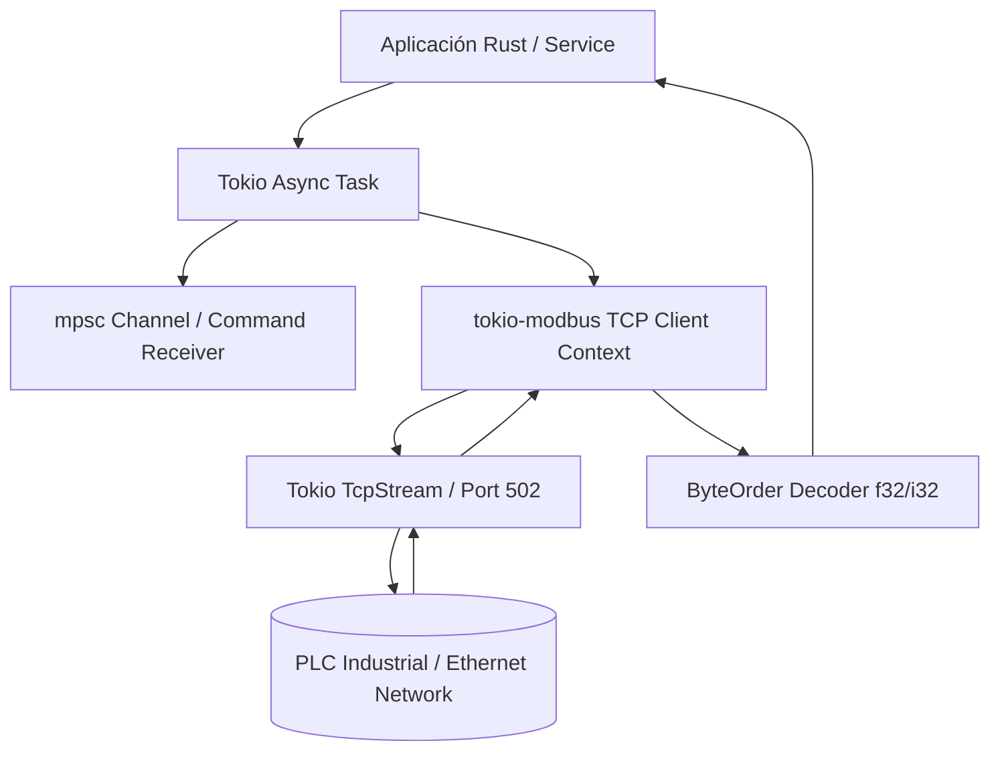

# 🦀🔌 Rust PLC Modbus Agent Skill (`rust-plc-modbus-agent-skill`)

> **Descripción** — Habilidad especializada para comunicación industrial asíncrona Ethernet TCP/IP con PLCs utilizando **Rust**, **Tokio** y `tokio-modbus`.

---

## 📌 Propósito y Alcance

1. ⚡ **Asincronía Ultra-Rápida**: Cliente Modbus TCP de latencia ultrabaja basado en el runtime de Tokio y `tokio-modbus`.
2. 🔄 **Operaciones Industriales Complejas**: Lectura/escritura de Holding Registers (FC03/FC06/FC16), Inputs (FC04), Coils (FC01/FC05) y Discrete Inputs (FC02).
3. 🔢 **Zero-Copy Endianness Parsing**: Decodificación de `f32`, `f64`, `i32`, `u32` en formatos BigEndian, LittleEndian y Swapped Words (`byteorder` crate).
4. 🧵 **Tokio Task Runner**: Bucle de supervisión asíncrono con reconexión automática en caso de caída de enlace Ethernet.
5. 🛡️ **Auditoría & Safety**: Verificación determinista de límites de memoria y tipos de registros sin peligro de panics (`$rustplc:audit`).

---

## ⚡ $-Comandos de Dominio

| Comando | Acción | Descripción |
|---|---|---|
| `$rustplc` | Bootstrap Skill | Carga los patrones y crates de comunicación Modbus TCP en Rust. |
| `$rustplc:audit` | Auditoría Industrial | Audita la salud de conexiones Ethernet y el mapa de registros en Rust. |
| `$rustplc:read [ip] [port] [reg]` | Snippet Lectura | Genera código asíncrono `tokio-modbus` para lectura de registro. |
| `$rustplc:task` | Scaffold de Worker | Genera un `tokio::spawn` worker loop con auto-reconexión TCP. |

---

## 🧩 Arquitectura / Diagrama de Flujo



---

## 📦 Instalación como Submódulo

```bash
mkdir -p .skill
git submodule add git@github.com:Agent-Rules-Ecosystem/rust-plc-modbus-agent-skill.git .skill/rust-plc-modbus-agent-skill
```
