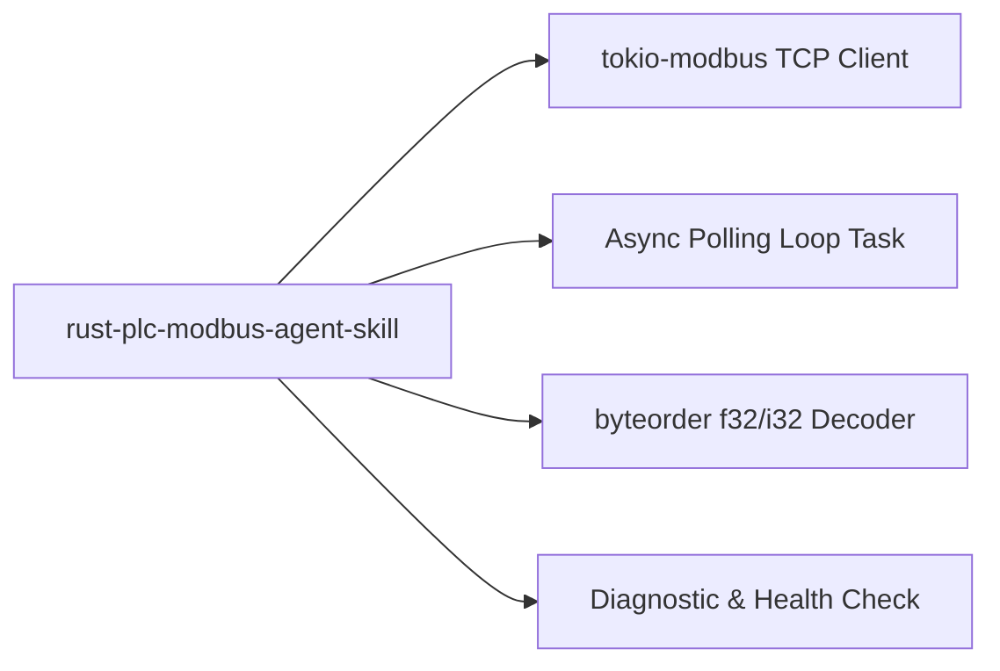

# 🦀🔌 Rust PLC Modbus Skill Matrix & Directives

## 🎯 Capacidades de la Habilidad



## 📋 Protocolo de Auditoría Industrial (`$rustplc:audit`)

Al ejecutar `$rustplc:audit`, el agente verifica:
1. **Configuración de Dependencias**: Presencia de `tokio-modbus`, `tokio` y `byteorder` en `Cargo.toml`.
2. **Resiliencia Tokio**: Verificación de manejo de reconexiones en `TcpStream`.
3. **Manejo de Errores Idiomático**: Retorno transparente de `tokio_modbus::Error`.
4. **Persistencia de Informe**: Escribir en `overview/work/skill/rust-plc-modbus.md` la tabla de registros analizados.

---

## 🛠️ Patrón Canónico de Código Rust (`tokio-modbus`)

```rust
use std::net::SocketAddr;
use tokio_modbus::prelude::*;

pub async fn connect_plc(addr: SocketAddr) -> Result<Context, tokio_modbus::Error> {
    let ctx = tcp::connect(addr).await?;
    Ok(ctx)
}

pub async fn read_holding_registers(
    ctx: &mut Context,
    addr: u16,
    cnt: u16,
) -> Result<Vec<u16>, tokio_modbus::Error> {
    let data = ctx.read_holding_registers(addr, cnt).await??;
    Ok(data)
}
```
